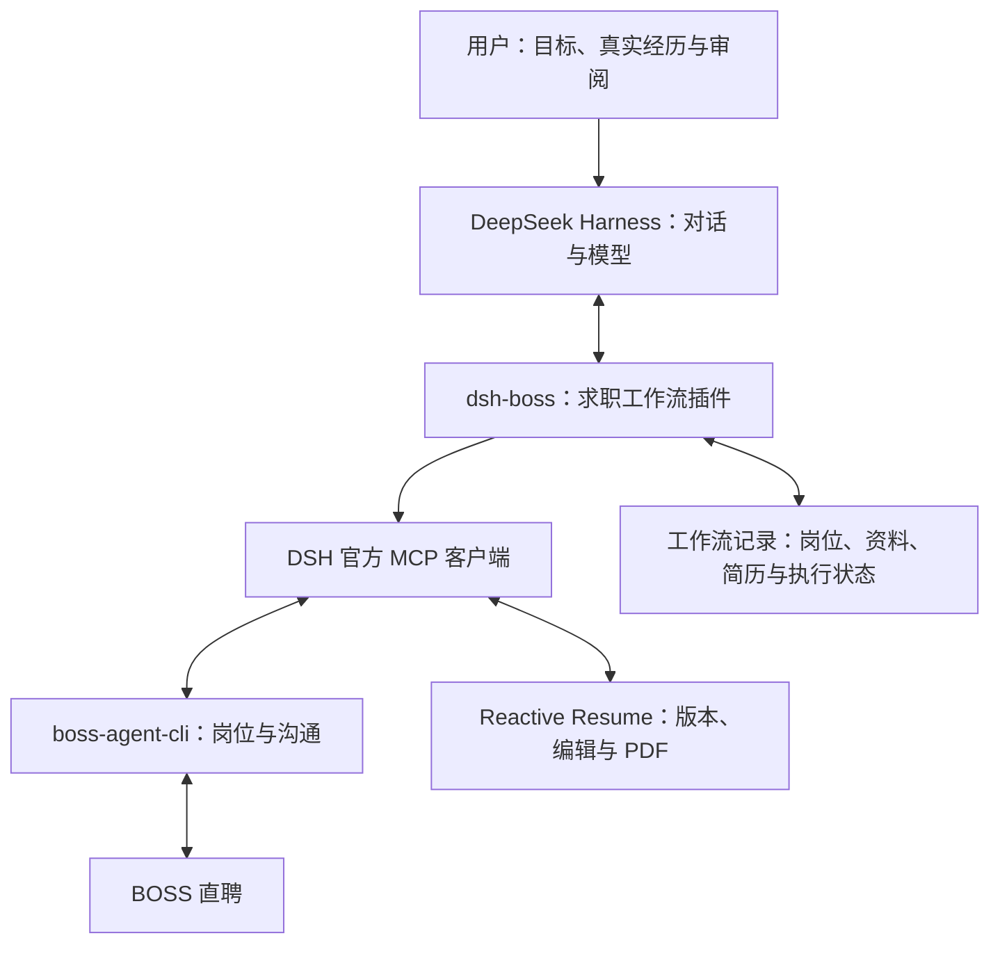

# dsh-boss

面向 **[DeepSeek Harness（DSH）](https://github.com/deepseek-ai/deepseek-harness)** 的求职助手插件：在 AI 对话中按地域发现岗位，结合真实个人经历定制简历，生成可审阅的文件，并在用户确认后推进沟通和投递。

> **当前状态：M2 已实现，插件 0.2.4 可本地安装到 DSH 0.2.1-rc.2。** 保留对话为主、右侧工作台；直接在插件内扫码连接 BOSS，使用 MCP 搜索/详情/去重保存，以及无需 Key 的百度官方地图、Photon 地址候选和人工坐标确认。登录与读取复用专用 Chrome，方式参考 BossHunter；真实岗位验收状态见下方说明；简历 PDF 和平台沟通尚未接入。
>
> **真实验收限制：** 已定位跳转链为搜索 → BOSS 官方安全检查 → 搜索循环 → 首页；本人手动搜索也复现。登录记录保留，插件已暂停搜索，不要求反复扫码，也不再为搜索新增标签页。尚未取得真实岗位，真实搜索 → 导入 → 公司定位仍未通过；本地记录和地图验收单列。没有真实投递。

> [M2 安装与验收说明](docs/m2-implementation.md) · [M1 历史记录](docs/m1-implementation.md) · [技术架构](docs/technical-architecture.md) · [产品设计](docs/product-frontend-design.md)。实现验证日期：**2026-10-27（Asia/Shanghai）**。

## 快速开始

```sh
npm ci
npm run boss:setup
npm run check
npm pack --pack-destination artifacts
dsh plugin --profile web add /absolute/path/dsh-boss-0.2.4.tgz
npm start
```

首次体验可使用独立 `DSH_HOME`，见[M2 安装说明](docs/m2-implementation.md#安装与启动)。右侧栏 → **我的求职** → **显示登录二维码**，用 BOSS 直聘 App 扫码并在手机确认；无需提供 DeepSeek Key、BOSS Key 或 Cookie。随后在原生对话中说「搜索西安的 AI 平台岗位」，或直接在右侧搜索。左栏同名入口可跨会话查看。机会数据保存在 `$DSH_HOME/dsh-boss/state.sqlite`；卸载保留记录。

## 项目目标

最终交付一个可在 DeepSeek Harness 中安装、配置和卸载的插件。用户通过自然语言完成以下流程：

1. 导入基础简历，补充真实项目、本人职责、技能、成果和求职偏好。
2. 按城市、岗位关键词、薪资和经验等条件搜索，分页获取并去重。
3. 获取完整岗位描述（JD），解释匹配依据、硬性缺口和待确认条件。
4. 为选定岗位创建独立简历版本，调整表述和重点，展示修改依据并导出 PDF。
5. 用户审阅后，针对明确的岗位、消息和简历版本执行已支持的沟通或投递动作。
6. 记录实际执行结果、回复和面试进展。

预期交互示例（尚未实现）：

> 帮我找杭州和上海的 Python 后端岗位，先看两页。根据我的经历选出五个，分别生成针对性简历，展示修改依据和 PDF；我确认后再发起沟通。

“提升命中率”是需要验证的产品目标。以实际回复率、面试邀请率和简历采用情况观察效果，不将 AI 自评分上升当作求职效果提升。

## 目前的方向与决策

前期曾评估基于 [BossHunter](https://github.com/shengjidaguai-china/BossHunter) 二次开发完整网页求职工作台，也考虑过从零实现岗位 MCP 和简历 MCP。进一步调研发现，岗位操作和简历编辑已有可复用项目。

当前选择是：**以 DSH 插件作为最终产品，优先组合现有 MCP，针对实际缺口补充适配与工作流。**

| 事项 | 当前决定 |
| --- | --- |
| 产品形态 | DeepSeek Harness 插件；MCP 是集成方式 |
| BOSS 岗位入口 | 优先验证 `boss-agent-cli` |
| 简历编辑与导出 | 优先验证 Reactive Resume 自带 MCP |
| AI 分析与改写 | 优先由 DSH 当前模型完成 |
| 插件自身职责 | 连接配置、求职工作流、个人事实与岗位版本关联、审阅和执行状态 |
| 开发策略 | 先跑通单岗位流程，再扩展多城市和批量处理 |
| 原网页工作台路线 | 保留调研参考，当前仓库不迁入其代码 |

以上是选型方向，不代表依赖已经接通或适配完成。首次提交不包含个人简历、浏览器会话、账号凭据或运行数据。

## 调研依据

### 1. DSH 已有 MCP 接入能力

DeepSeek Harness 基于 Cordis 插件机制。官方 `@deepseek-ai/dsh-mcp-client` 支持本地 stdio 和远端 Streamable HTTP，并将外部工具注册到 Harness；每个服务器使用独立名称，可同时连接岗位和简历服务。

因此，首选复用 DSH 官方 MCP 桥接能力，插件补充求职领域的配置和流程。官方文档当前注明 **MCP prompts 模板不受支持**，不能只依赖第三方 MCP 的 prompts 来实现求职流程。DSH 仍处于预览阶段，实际开发时需固定版本并验证兼容性。

依据：[官方仓库](https://github.com/deepseek-ai/deepseek-harness)、[MCP 客户端](https://github.com/deepseek-ai/deepseek-harness/blob/master/packages/mcp/mcp-client/README.zh.md)、[MCP 边界](https://github.com/deepseek-ai/deepseek-harness/blob/master/docs/subsystems/mcp.zh.md)、[插件教程](https://github.com/deepseek-ai/deepseek-harness/blob/master/docs/cordis-tutorial/01-first-plugin.zh.md)。

### 2. 岗位侧：优先 boss-agent-cli

| 候选项目 | 核对到的能力 | 对本项目的判断 |
| --- | --- | --- |
| [can4hou6joeng4/boss-agent-cli](https://github.com/can4hou6joeng4/boss-agent-cli) | MCP 搜索支持关键词、城市、薪资、经验、学历、福利和 `page`；提供详情、本地候选池、简历与沟通工具 | 首选验证，最贴近求职者流程 |
| [Douyh123/boss-agent](https://github.com/Douyh123/boss-agent) | 城市搜岗、详情、简历建议和沟通；搜索工具暴露 `limit`，未暴露独立翻页参数 | 可作参考，分页与简历成品流程需补 |
| [mucsbr/mcp-bosszp](https://github.com/mucsbr/mcp-bosszp) | 推荐岗位分页、经验和薪资筛选、打招呼；推荐工具未暴露城市和关键词 | 不优先作为按地域主动搜岗入口 |
| [namejiahui/mcp-boss-zp](https://github.com/namejiahui/mcp-boss-zp) | 当前主分支主要提供读取浏览器当前岗位与点击沟通 | 功能较基础，注意网上旧版本介绍与当前实现的差异 |
| [Snseam/boss-zhipin-mcp](https://github.com/Snseam/boss-zhipin-mcp) | 候选人搜索、简历查看和招聘筛选 | 招聘者端，与本项目的求职者目标不同 |

`boss-agent-cli` 的两个边界直接影响后续实现：

- `boss_ai_optimize` 返回优化后的简历结构，不直接保存为可投递文件；本项目优先让 DSH 模型改写，再由简历服务保存和导出。
- `apply` 当前复用“立即沟通”链路，不能据此声称已发送指定的定制 PDF。附件发送和结果核验是单独的适配项。

依据：[MCP 工具定义](https://github.com/can4hou6joeng4/boss-agent-cli/blob/master/src/boss_agent_cli/schema/tool_catalog.py)、[搜索分页实现](https://github.com/can4hou6joeng4/boss-agent-cli/blob/master/src/boss_agent_cli/commands/search.py)、[apply 实现](https://github.com/can4hou6joeng4/boss-agent-cli/blob/master/src/boss_agent_cli/commands/apply.py)。上述 BOSS 项目为第三方实现；本次未找到 BOSS 官方公开提供的求职 MCP。

### 3. 简历侧：优先 Reactive Resume

| 候选项目 | 核对到的能力 | 取舍 |
| --- | --- | --- |
| [Reactive Resume](https://github.com/reactive-resume/reactive-resume) | 自带 MCP；读取、复制、JSON Patch 修改、版本恢复、PDF 下载；可托管或自部署 | 首选，覆盖大部分简历管理和产出需求 |
| [end1989/tailored](https://github.com/end1989/tailored) | 本地经历母版、岗位关联、MCP 保存、结构化事实检查、版本记录、PDF/HTML/纯文本导出 | 备选，更贴近经历库；项目较新，中文排版需验证 |
| [HireTechUpUp/upcv-mcp-server](https://github.com/HireTechUpUp/upcv-mcp-server) | 细粒度简历编辑、样式与模板、PDF 导出 | 开源的是接入层，实际依赖 UPCV 账号和积分服务 |

Reactive Resume 已提供 `read_resume`、`duplicate_resume`、`apply_resume_patch`、`download_resume_pdf` 及历史版本工具。计划先复制母版，再由 DSH 模型针对 JD 修改副本，保留可恢复的历史。基础读写与导出不要求另配模型服务；它内置的评分和自动定制等 AI 工具另需配置提供方。

当前官方自部署方案主要需要应用和 PostgreSQL。源码已有中文字体选项与 PDF 字形回退处理，但部分字体依赖在线下载；仍需用中文样例验证字体、换行、分页和下载。不能假设导入原 PDF/Word 后会完整保留原有版式。

依据：[MCP 文档](https://github.com/reactive-resume/reactive-resume/blob/main/docs/guides/using-the-mcp-server.mdx)、[工具实现](https://github.com/reactive-resume/reactive-resume/blob/main/packages/mcp/src/tools.ts)、[Docker 部署](https://github.com/reactive-resume/reactive-resume/blob/main/docs/self-hosting/docker.mdx)、[字体说明](https://github.com/reactive-resume/reactive-resume/blob/main/docs/self-hosting/fonts.mdx)、[Tailored 保存逻辑](https://github.com/end1989/tailored/blob/main/backend/mcp_ops.py)。

## 拟议架构



这是职责划分示意，不是已实现的调用图。插件直接调度与模型调用工具的边界、配置包装方式和持久化格式，留待 DSH 联调确定。

插件需要补充的核心逻辑：

- **事实与版本关联**：关联个人资料版本、JD 快照、简历版本和导出文件。缺少依据的内容列为待补充，不写成已掌握。
- **地域搜索与分页**：编排“城市 × 关键词”，区分平台续取和本地结果分页，去重并保留续取位置。结束、登录失效、限流和解析失败必须可区分。
- **修改审阅**：展示 JD 要求、原始经历依据、修改内容和理由；结构校验不能代替内容审阅。
- **执行记录**：区分已准备、待确认、已发起沟通、已发送附件、结果未知和失败。超时不能直接视为未发送并重试。
- **文件衔接**：将简历服务的下载结果关联到明确岗位和版本；PDF 导出成功不等于已经向招聘者发送。

## 实施顺序与验收

| 阶段 | 交付内容 | 验收标准 |
| --- | --- | --- |
| M0：调研记录 | 本 README | 明确最终插件目标、选型依据、未验证项和首版边界 |
| M1：本地记录与工作台（已实现） | 可安装插件、SQLite、本地 MCP、人工表单 | UI/MCP 同一数据；来源、保护、候选、冲突、撤销；宿主加载与持久化 |
| M2：按地域发现岗位 | 城市与关键词搜索、分页、去重、完整 JD | 验证至少两个城市和连续两页；记录结果来源与停止原因；缺 JD 不冒充完整匹配 |
| M3：单岗位简历产出 | 母版副本、修改依据、版本保存和 PDF | 同一资料面对两个 JD 产生不同重点；不覆盖母版；中文 PDF 可下载且排版可读；可恢复旧版 |
| M4：沟通与投递衔接 | 确认、执行记录、去重与结果核验 | 沟通与附件发送分别验收；每次动作关联明确岗位和材料；结果未知时先核验 |
| M5：批量与跟进 | 多岗位任务、停止恢复、回复与面试记录 | 单项失败不丢其他成果；重启可恢复；用实际求职反馈评估效果 |

首个功能验证范围是 **DSH 中指定城市搜索 → 连续两页 → 获取完整 JD → 生成一个岗位的中文简历 PDF**。不以单个 MCP 的成功调用代替完整流程验收。

## 当前不包含

- 可安装的插件包、真实账号联调或生产可用承诺。
- 无人确认的批量沟通、附件发送或自动回复。
- 从零重写 BOSS 采集器、简历排版引擎或完整网页工作台。
- 多用户 SaaS、付费套餐及跨平台招聘聚合。
- 对面试、录用或命中率提升的保证。

后续实现优先复用依赖的公开接口；引入第三方代码时另行核对和保留其许可证。凭据、个人资料与运行数据留在用户配置和存储中，不进入公开仓库。遇登录失效、验证码或平台限制时，应保留进度并停止相关操作，不尝试绕过。

## 下一步

按[技术架构设计](docs/technical-architecture.md)推进：以全局 DSH `0.2.1-rc.2` 为首轮基线，本轮已完成本地记录闭环；下一轮进入岗位 MCP、实际工作地点和地图接入，再推进单岗位中文 PDF。架构文档包含模块职责、数据模型、调用约束、审批与恢复、安装打包及 M1 至 M5 验收标准。

界面按[个人求职工作台设计（第二版）](docs/product-frontend-design.md)推进：保留 DSH 对话为主，右侧以“机会、跟进、我的资料”组织日常使用，增加地图与岗位联动。用户可直接编辑，AI 通过本地记录 MCP 与同一业务服务补充信息；保留字段来源、人工修正和冲突候选。地图默认展示岗位工作地点，未知地址不虚构坐标，真实通勤结果接通后再启用。
