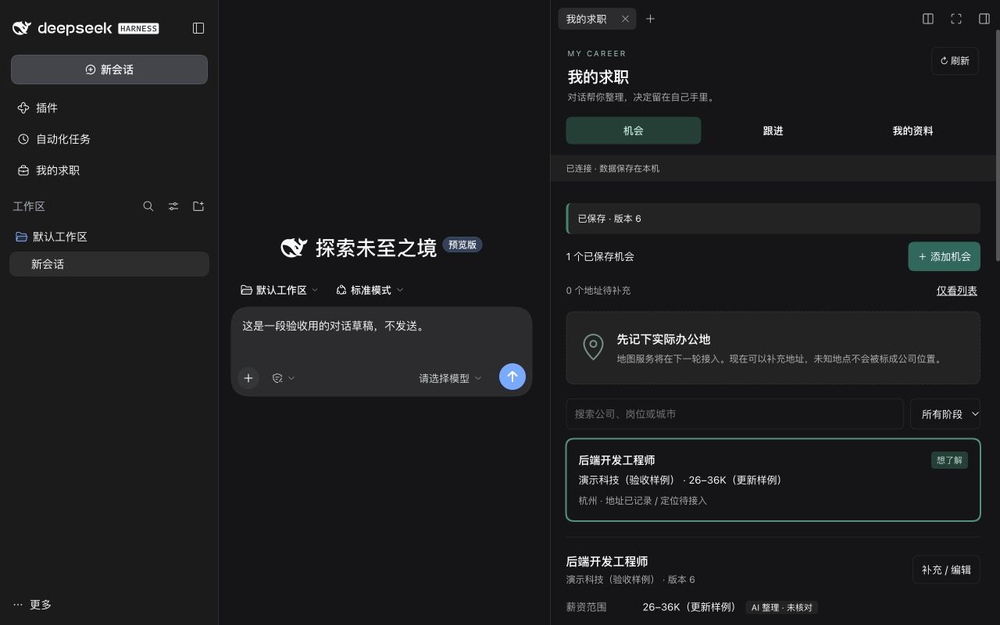

# M1 实现与验收

2026-10-27 · dsh-boss 0.1.0 · DSH 0.2.1-rc.2

本轮实现以[第二版产品设计](product-frontend-design.md)为准：DSH 对话是主界面，右侧“我的求职”长期保存机会、跟进和个人资料。全局同名入口用于跨会话查看，复用同一个组件和同一份数据。

## 已实现

- 可打包安装的 Cordis Host / Web Client 插件，使用 `dsh.bundle.patch` 和 `dsh.client` 声明。
- SQLite 统一记录服务：机会、唯一个人资料、revision、字段来源、人工保护、候选、变更日志和请求幂等。
- 右侧“机会 / 跟进 / 我的资料”，新增、编辑、筛选、个人阶段、下一步与计划日期。字段来源可展开，AI 整理的字段可由本人确认。
- 全局入口和右侧页签共用记录；草稿按对象保存在当前浏览器内存中，切页、隐藏、收起不混入其他对象。刷新或关闭浏览器前有未保存提示；草稿不跨浏览器重启恢复。
- 私有进程内 MCP。每次 DSH 调用绑定可信 AI 身份，创建 Client / Server 配对，执行后关闭；不新增网络监听端口。
- DSH 工具执行管道、guard 和取消继续生效；失败 MCP 信封转换成宿主工具错误，不能以成功工具状态掩盖失败。
- 认证 Host RPC 仅接受 owner Peer，人工身份来自宿主调用上下文；AI 参数不能携带 actor 或修改保护状态。
- 提交后通过插件自己的 Remote stream 通知对象 ID、revision 和变更 ID。订阅建立后读取快照；断线重连重新订阅和读取。编辑草稿不会被刷新覆盖。
- 撤销按字段 revision 检查。后来修改同一字段时拒绝覆盖；未修改的新增可撤销为归档，审计记录保留。

## 安装和运行

环境：DSH **0.2.1-rc.2**；Node **22.13+**（本轮实测 25.8.1）。先在仓库执行：

```sh
npm ci
npm run check
npm pack
```

建议使用独立测试数据目录启动第一次验收：

```sh
DSH_HOME=/tmp/dsh-boss-preview dsh web --help
DSH_HOME=/tmp/dsh-boss-preview dsh plugin --profile web add /absolute/path/dsh-boss-0.1.0.tgz
DSH_HOME=/tmp/dsh-boss-preview dsh web --no-open --port 8773
```

浏览器使用终端输出的本机地址完成首次认证。测试数据目录不包含现有 DSH 的模型凭据；手动表单不需要模型账号。右侧入口：打开 DSH 右侧栏 → “我的求职”；已有会话另有标题旁的“我的求职”按钮。左栏全局入口也可直接使用。

接入本人现有全局 web profile 时，使用不带 `DSH_HOME` 的命令（如自行设置过该环境变量，先核对目标）：

```sh
dsh plugin --profile web add /absolute/path/dsh-boss-0.1.0.tgz
dsh web
```

退出 DSH 后可卸载插件，业务数据仍保留：

```sh
dsh plugin --profile web remove dsh-boss
```

本轮只在 `/tmp` 隔离 profile 验收，未改动已清理的全局 profile、模型凭据或历史会话。无自动搜岗、外发消息或账号登录动作。

## 数据与边界

数据库位于 `$DSH_HOME/dsh-boss/state.sqlite`，默认即 `~/.dsh/dsh-boss/state.sqlite`。插件目录创建权限为 0700，数据库为 0600，使用 WAL、短事务和 schema_version（SQLite user_version=1）。未来非空迁移需要增加备份与迁移流程；当前只初始化 v1，遇到更高数据库版本拒绝打开。

当前是单个个人 DSH home 的数据集合，不是多租户服务。记录不随聊天删除而删除。Host RPC 使用相同 Gateway 认证并再检查 owner；没有第三方 HTTP 写入口。私人资料只在用户明确求职任务下经工具进入模型，页面选择本身不发模型请求。

第一版用 `records` 聚合保存岗位和资料，`changes` 保存变更，`requests` 保存幂等回执。公司名称和工作地址暂为机会字段，不会按同名公司自动合并。独立公司、多个工作地点、外部平台 ID 和资料事实实体将在 M2/M3 有真实来源合同后迁移。变更查询只返回涉及字段的历史值与候选，不把整条前后快照重复塞进每个结果。

写入请求包含 `requestId`；更新包含 `expectedRevision`。相同身份和请求编号、相同载荷返回原回执；载荷不同拒绝。版本落后时不写任何字段，UI 保留草稿并展示最新值，用户核对后可继续编辑。人工清空的字段仍受保护。AI 对保护字段的不同值形成候选，可与其他可写字段在同一事务内部分提交；回执分别列出 `appliedFields` 和 `proposedFields`。

AI 来源包括引用的用户原文或外部来源。来源引用由模型提供，不等于插件独立核验；AI 字段一律为 unverified。只有本人经认证表单确认后才能变成 confirmed。外部字段内容始终是资料，不是新的权限或工具指令。

计划日期使用明确 `YYYY-MM-DD`，只是本人的安排，没有后台提醒。人工标记“已联系”不表示招聘平台已经发送消息。未接入定位服务：地址有值时为 unresolved，坐标为 null；未知地址仍在列表中。当前没有任何合成地图点或伪造通勤时间。

## MCP 和宿主接口

锁定 `@modelcontextprotocol/sdk` 1.32.2，使用官方 `InMemoryTransport.createLinkedPair()`；这是插件私有 Client 的传输，不是 DSH 官方 MCP 桥接的新增功能。[官方接口源码](https://github.com/modelcontextprotocol/typescript-sdk/blob/v1.x/src/inMemory.ts)

| 模型工具 | 本轮能力 |
| --- | --- |
| `dsh_boss_status` | 已连接/尚未接入能力 |
| `career_list_records` | 读取机会、个人资料 |
| `career_get_record` | 读取字段、来源和当前 revision |
| `career_create_opportunity` | 保存来源明确的新机会 |
| `career_update_record` | 补充字段，保护字段生成候选 |
| `career_get_changes` | 查询实际变更和候选 |

用户在 DSH 中可说：“把我刚才提到的公司和岗位保存到我的求职，缺失的薪资和地址留空。”模型需要使用工具获得真实回执。人工候选确认和撤销不暴露成 MCP 工具。M1 没有模拟 AI 按钮；AI 操作仍从原生对话发起，不修改现有输入草稿或附件。

远程命名空间为 `dshBoss`：`list/get/create/update/changes/resolve/undo/watch`。Host 和 Client 共用明确的 Typert invocation 描述及 schema；Client 先挂载贡献，再用 `ctx.inject(['remote.dshBoss'])` 挂载工作台，严格解开宿主 `RemoteResult.value` 与内部业务结果。输入长度、字段白名单、日期、URL 协议和未知键由完整 Zod schema 检查。

## 验证记录

`npm run check`：TypeScript 检查、20 项测试、Host/Client 构建通过。

| 验证 | 证据范围 |
| --- | --- |
| SQLite | 同一对象人工/AI 更新、跨连接 CAS、幂等及请求参数冲突、落盘重开 |
| 字段规则 | 人工保护、人工清空、来源要求、非法字段/日期、AI 不能自报 actor |
| 候选与撤销 | 接受/保留、迟到候选、ABA 字段修改、保留无关字段、归档与审计、旧候选不被近期历史截断 |
| MCP SDK | 实际协议发现和读写、结构化错误信封、取消与关闭 |
| 实际 DSH 服务 | Cordis + ToolRuntime + TypertGateway：owner RPC、工具管道、guard 拒绝、取消、提交通知、卸载后撤销接口与重载恢复 |
| 前端状态 | transport/business 两层信封、迟到响应不覆盖新状态、失败保留旧记录、对象独立草稿、显式核对及保存期间的新编辑 |
| 浏览器 | 安装 tgz 后实际 DSH 页面加载、全局和右侧入口、人工保存、MCP 候选保留、切页草稿、并发版本核对、撤销、重启恢复；1280px 桌面和 390px 窄屏暗色主题检查通过 |

上述测试不等于真实模型已选对工具，也不证明第三方岗位、地图、PDF 或沟通能力。没有消耗模型请求完成外部业务。

依赖审计：插件自身 Zod 已固定到 4.6.6，修复 GHSA-mrhx-c7xc-m3w5。DSH 0.2.1-rc.2 的依赖链仍固定旧版 Zod，npm 会报告该上游告警；未用 overrides 悄悄改写宿主依赖。正式升级宿主时需重做兼容与审计检查。

## 下一轮

M2 接真实岗位来源、稳定 ID 去重、完整 JD、公司工作地点解析和真实地图；M3 再加入事实级资料与简历产物。当前地图、BOSS 搜索、简历生成、真实沟通都明确显示尚未接入，不能当作已完成能力验收。

## 实际界面

以下是隔离 DSH 的真实界面，内容是合成验收样例；原生对话仍为主界面。


