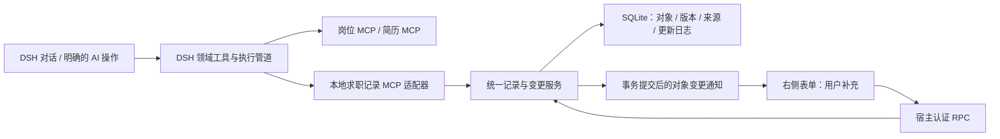

# 个人求职工作台：产品与前端设计

> M2 实现状态见 [真实地图与 BOSS 岗位发现](m2-implementation.md)。当前 0.2.3 使用百度官方免 Key 地图，Photon / 手动编辑器确认 WGS84 坐标；BOSS 改为 BossHunter 式专用 Chrome 会话读取；下文保留完整目标架构与后续阶段。

第二版 · 2026-10-26 · 产品设计

2026-10-27：M1 已实现真实本地记录与右侧工作台；具体完成项和未接入能力见 [M1 实现与验收](m1-implementation.md)。

**最新产品决策：保留 DSH 对话为主，右侧增强为可长期维护的个人求职工作台。** 本稿替代[第一版前端方案](frontend-design.md)中的产品结构；第一版已核对的宿主扩展点可继续作为接口参考。配套：[技术架构](technical-architecture.md)。

## 1 产品要解决的问题

用户需要的是持续找工作的个人助手：看公司在哪里、比较机会、维护真实经历、准备材料、记下下一步。AI 与用户共同维护一份可编辑的记录，聊天结束后成果仍然存在。

第一版过于围绕工具结果展示。这一版把“机会、跟进、我的资料”放到前台，工具名和 MCP 日志只出现在开发诊断中，不占据日常使用界面。不引入企业 CRM 的团队、负责人、营销漏斗或管理后台，不用一排 KPI 或模型评分替代实际判断。

首个可用闭环为 **聊目标 → AI 保存机会 → 地图和列表比较 → 用户补充 → 岗位简历 → 留下下一步**。真实平台沟通仍是 M4 单独验收的能力，个人跟进记录不等于自动发送。

## 2 页面与主次关系

| 界面 | 用途 | 直接操作 |
| --- | --- | --- |
| DSH 原对话 | 表达目标、询问原因、让 AI 搜索和整理 | 原输入框、模型选择、原生工具执行与审批 |
| 右侧“机会” | 比较已保存岗位与工作地点 | 地图/列表互选、筛选、添加、补充信息、让 AI 补全、准备简历 |
| 右侧“跟进” | 记住下一步和最近沟通 | 改个人阶段、记备注、设计划日期、关联简历 |
| 右侧“我的资料” | 可复用的求职偏好和真实经历 | 直接编辑、让 AI 整理、核对事实、维护母版 |
| 原生 PDF 页签 | 查看一个明确版本的真实产物 | 预览、下载与文件核验 |
| 全局“我的求职”入口 | 无会话时查找记录、恢复关联会话 | 复用同一工作台视图，不另做一套业务后台 |

右侧只有一个顶层“我的求职”页签，三个业务页在内部切换。默认地图在上、紧凑岗位列表在下，选中后显示一份详情；侧栏不再挤出第三列。只想浏览文字时可切换“仅列表”。复杂地图和长篇简历使用 DSH 原生全屏，返回后保留选择、地图视角与未保存草稿。

原型用约 55% 展示右侧，便于讨论密度；正式版尊重 DSH 默认布局与拖拽记忆，不覆盖宿主宽度策略。窄屏显示一个主视图，提供回到对话入口。原型中的导航压缩用于演示，实际左栏仍由 DSH 管理。

## 3 地图：知道这个岗位在哪里上班

地图关联的是 **岗位工作地点**，不默认用公司总部或工商注册地址。同一公司多个岗位或办公地点分别关联；面试地点也不能覆盖办公地点。

| 位置状态 | 显示 | 用户操作 |
| --- | --- | --- |
| 已确认工作地点 | 实心标记、完整地址、来源与核对时间 | 看详情、复制地址、查看路线 |
| 只知道商圈/园区 | 空心区域标记，明确“大致位置” | 补充楼栋、选择更准确的候选 |
| 存在多个候选 | 详情列候选，不擅自定位其中一个 | 确认实际办公地或继续询问 |
| 未知地址 | 保留在列表，计入“地址待补充” | 手动填写或让 AI 查找 |
| 远程/混合办公 | 显示工作方式；办公室另行关联 | 不强行纳入某个通勤半径 |

地图与列表双向联动：点击标记选择对应机会，点击岗位高亮标记。筛选同时作用于两处；未知地址不从总数中消失。同地点多个岗位聚合显示数量，展开后选择具体岗位。

人工修改地址后，旧坐标和路线立即过期。解析成功并核对前显示“定位待确认”，不能让旧标记继续代表新地址。AI 找到另一个地址时保存为候选，不覆盖用户已确认的值。

### 可选通勤能力

不自动索取设备定位。用户可以选一个地铁站、商圈或自定义起点，未设置也能使用地图。首版可只展示位置与导航入口，真实路线服务接通后再提供通勤时间。

路线结果带出行方式、查询时间、地点精度和来源；直线距离不能标成通勤距离，没有真实查询结果时不填“35 分钟”。地图提供方只接收必要地址或起终点，不接收简历和私人备注；精确起点保存在私有配置中，不进入普通模型上下文与诊断日志。

## 4 机会与公司详情

每条机会有岗位、公司、薪资、工作区域、个人阶段与下一步。详情依次展示岗位事实、工作地点、我的判断与备注、相关材料。来源按字段展开，不要求用户阅读工具 JSON。

公司资料可复用，但岗位和工作地点独立。使用平台稳定岗位 ID 去重；同名公司在归属不明时保留候选，不自动合并。只有列表摘要时明确标注尚缺完整 JD。

用户可直接添加从朋友、邮件或网站看到的机会，先填公司与岗位，其余逐步补充。没有地址或完整 JD 也可以保存；不因资料不齐阻止记录，也不让 AI 将空白补成事实。

## 5 人工补充、保存与冲突

用户不必通过聊天才能改备注、地址、阶段、跟进日期或经历。表单采用“编辑 → 保存/取消”，明确显示未保存、保存中、成功与失败；避免复杂资料在用户不知情时逐字自动保存。

- 编辑草稿按对象保留，切换岗位或收起面板不会混到另一个对象。将丢失草稿时提供保存、保留草稿或放弃选择。
- 用户确认或手动修正的字段默认受保护；AI 可以填空和追加来源明确的信息，更改受保护字段时生成候选。
- 来源和核对状态分开：来源是用户、招聘页、简历母版等；状态是已核对、未核对或候选。AI 不是个人经历真实性的来源。
- AI 从用户陈述提取的信息标为“来自你的补充”，没有来源的推测留作待核对；不能自行升级为已掌握技能。
- 撤销针对一笔本地变更，使用字段与 revision 比较；后续已经修改同一字段时先处理冲突，不能恢复整个旧快照覆盖新编辑。

不要求每次 AI 更新都逐项审批。明确任务下的补齐空字段、保存搜索结果和整理用户已提供信息可以直接提交，成功后给出可查看的变更回执；冲突、不确定事实和外部动作才需要额外处理。

## 6 AI 调用 MCP 写入同一份记录

界面由已提交业务数据驱动，不能因为模型说“已保存”就展示成功。岗位 MCP、简历 MCP 与本地记录 MCP 各司其职。

本地记录 MCP 是本项目需要实现的组件；BOSS 和 Reactive Resume 不负责保存我们的个人备注、地图核对、跟进日期及字段保护规则。首版 MCP 适配器、业务服务和 Repository 同处插件进程，前端 RPC 与 MCP 调用同一个业务服务，保持单一写入规则。

可用官方 TypeScript SDK 的 `InMemoryTransport.createLinkedPair()` 建立进程内 MCP Client/Server，无需为个人资料新开公共端口。模型侧的 DSH 领域工具通过私有 SDK 客户端调用本地 MCP，仍保留宿主工具执行、取消及策略管道。这不是宣称 DSH 官方桥接已支持内存传输；M1 已锁定 SDK 1.32.2 并验证打包。[SDK 源码](https://github.com/modelcontextprotocol/typescript-sdk/blob/v1.x/src/inMemory.ts)

| 拟议本地 MCP 工具 | 职责 | 约束 |
| --- | --- | --- |
| `career_list_records` / `career_get_record` | 读取机会、公司、资料与修订 | 只读，服务端检查归属 |
| `career_import_jobs` | 保存搜索快照并关联机会 | 稳定 ID 去重、保留原始来源 |
| `career_update_record` | 补齐字段、写入用户表达的偏好和备注 | 字段白名单、expectedRevision、requestId、保护检查 |
| `career_add_fact` | 整理经历与原文引用 | 来源必须可核对，不接受自报 verified=true |
| `career_record_followup` | 保存个人阶段、摘要、下一步 | 不伪装成平台执行结果 |
| `career_resolve_location` | 地址解析与候选关联 | 精度明确，冲突值不覆盖人工确认 |
| `career_get_changes` | 查询变更回执、冲突与候选 | 反映真实提交情况 |

写入返回 `recordId/revision/changeSetId/appliedFields/proposedFields/conflicts`；按 schema 使用 `structuredContent` 并提供兼容文本摘要。候选字段未提交时不能回复“全部更新成功”。服务端确定 actor、会话身份和来源可信度，不能接受模型参数 `actor=user`、`approved=true` 等绕过规则。MCP 工具注解不是授权依据。[MCP 工具合同](https://modelcontextprotocol.io/specification/2025-06-18/server/tools)

### 一次 AI 更新的完整反馈

1. 用户提出“补齐这些岗位的地址，保留我的备注”，或点击明确的“让 AI 补全”。请求固定对象 ID 与当时 revision。
2. DSH 调用上游 MCP 获取信息；已有记录继续可读、可编辑。
3. 适配器保存来源快照，再通过本地记录 MCP 提交变更；服务校验字段保护与并发版本。
4. 事务提交后通知 UI，显示“已补充 2 处 · 1 处待确认”，并提供变更详情。
5. 不在编辑的字段同步更新；正在编辑的字段保留草稿并提示新版本，禁止静默覆盖。
6. 用户可保留原值、采用候选或撤销本地变更。撤销不撤回真实平台沟通。

业务通知由插件 Host 提供，带对象 ID、revision 和 changeSetId；断线后重新读取权威快照。MCP 的 `tools/list_changed` 是工具目录变化，不能当作业务数据更新通知。

## 7 跟进：围绕下一步

窄侧栏使用下一步列表和轻量阶段分组，不默认横向看板。个人阶段为想了解、准备中、已联系、面试、已结束，可附结束原因。

每条显示岗位、下一步、明确日期、相关简历与最近备注。用户可以直接记“已电话沟通，周五等反馈”，AI 也能整理用户明确说过的信息；相对时间由 Host 按时区转换成具体日期。

用户标记“已联系”是个人记录；经核验的工具 `CHAT_STARTED` 是平台事件，两者分别保存并标来源。发送超时且可能已生效时显示“结果待核验”，不提供直接重发。首版日期只是计划，不代表已经配置提醒或后台调度。

## 8 我的资料与简历

资料包括目标城市、岗位方向、薪资、工作方式、可选通勤偏好，以及项目、本人职责、真实技能和成果依据。用户编辑和 AI 整理进入同一版本体系。

AI 可以调整结构和表述，不能替用户确认无依据的数字、年限和职责。资料更新后提示哪些岗位简历需要重做，不自动覆盖已审阅文件。每个岗位生成独立副本，保留母版。

内容审阅核对改写及事实依据；文件审阅核对真实 PDF 的中文字体、换行和分页；对外动作另行确认。原生 PDF 只打开合法的 Host 产物引用，不直接将临时签名 URL 或任意本机路径交给浏览器。

## 9 DSH 接入边界

继续复用原对话、原输入框、模型选择、工具树、审批和文件预览，不创建第二套聊天。

| 需求 | 已核对的宿主入口 | 接入要求 |
| --- | --- | --- |
| 会话工作台 | `sidebarRightTabs.register`、`sidebar.right.pane.tab`、`openTab` | keyed 内容用 definition.id；验证参数与 Session |
| 跨会话找回 | `sidebar.panellist` + keyed `main` | 复用同一视图，业务记录不随会话删除 |
| 更新回执 | `tool.call.toolview` | 展示本次提交快照，不能用最新记录替换历史 |
| 直接编辑 | 插件 Host RPC | 不启动模型，不写招聘平台 |
| 连接与地图设置 | `settings.section`、`ctx.configForms` | 凭据引用、revision 冲突和卸载生命周期 |

“让 AI 补全”是明确的执行动作，空闲且输入合同验证通过时可直接启动指定任务，不必所有按钮都先填草稿再点发送。但必须保留现有草稿和附件；不能用 `setDraft` 伪装无损追加。忙碌、草稿占用或无法保证无损发送时暂存待发送请求，沿用宿主队列/补充语义。M1 保留从原生对话发起 AI 操作，未添加自动发送按钮；安全发送适配在后续入口实现时验证。[DSH 对话合同](https://github.com/deepseek-ai/deepseek-harness/blob/dsh-v0.2.1-rc.2/packages/client/ui-conversation/README.md)

选择地图或切页本身不会将资料送入模型。明确 AI 操作才附加授权对象引用；执行中切换岗位不改变请求目标。关闭或收起页签不等于取消 Host 已接受的任务。

## 10 地图技术与数据扩展

国内岗位优先评估高德 JS API 2.0 与地理编码/POI 服务，正式接入时确认账号、配额及使用条款，不预设永久免费。SDK 负责底图、平移、缩放和聚合，插件维护岗位覆盖物与联动。[地理编码](https://lbs.amap.com/api/webservice/guide/api/georegeo/)

以 `MapViewAdapter`、`LocationProvider` 隔离地图展示与解析；解析和路线查询经 Host 处理。JS 安全密钥与服务密钥按官方安全代理方案保存在服务侧，Web key 使用对应的来源限制；验证 DSH CSP、SDK 资源域、代理路由和卸载清理。[安全代理方案](https://lbs.amap.com/api/javascript-api-v2/guide/abc/jscode)

坐标保存 provider、CRS、来源与精度。高德使用 GCJ-02，不把 WGS84/BD-09 直接叠加。原型采用公开 OSM 几何与 WGS84 地标，未接入高德；正式迁移需经合法提供方转换并验证，不能复用演示坐标当成公司地址。[高德坐标说明](https://a.amap.com/jsapi/static/doc/index.html)

| 实体 | 关键字段 |
| --- | --- |
| `companies` | 名称、提供方标识、简介与来源；同名候选不自动合并 |
| `opportunities` | 岗位/公司引用、个人阶段、收藏、备注、下一步、revision |
| `work_locations` | 地点角色、原始地址、候选、坐标/CRS、精度、核对状态 |
| `field_provenance` | 字段、原文来源、观察时间、核对与人工保护状态 |
| `change_sets` | 可信 actor、旧新值、提交/候选/冲突、修订、撤销关系 |
| `followups` | 机会、下一步、日期/时区、完成状态、个人或平台证据 |

统一 service/repository 负责短事务、版本比较、requestId 幂等和更新日志，网络操作不在数据库事务里。允许部分提交时明确返回应用字段与候选字段；前端不能只看 HTTP 200 判成功。

未配置地图、断网或额度耗尽时，地址文本、列表和人工编辑仍然可用。大致位置不参与精确通勤筛选，不用城市中心的假点填补未知地址。

## 11 实施与验收

| 阶段 | 交付 | 关键验收 |
| --- | --- | --- |
| M1 | DSH 骨架、统一记录服务、本地记录 MCP、人工表单 | UI/MCP 维护同一对象；来源、冲突、撤销；草稿不受损 |
| M2 | 岗位 MCP、地图定位、列表联动、个人跟进 | 连续两页、未知/多地点、人工改地址后旧点失效 |
| M3 | 资料事实、岗位简历、审阅与真实 PDF | 母版保留、人工资料不覆盖、内容与文件分别核验 |
| M4 | 真实沟通与执行证据 | 原生审批、实际动作语义、未知效果不重发 |
| M5 | 批量、复杂跟进、可选提醒与通勤增强 | 部分失败恢复、真实提醒调度和路线结果 |

产品验收看用户能否完成任务：找到位置合适的机会、不经过聊天保存补充、理解 AI 改动、保留人工修正、重启后继续跟进。技术验收覆盖迟到响应不串对象、编辑草稿不被推送覆盖、撤销冲突、断线同步、同公司多地点、地图和列表数量一致，以及明暗主题和窄屏。

本轮原型是合成数据的交互演示，地图底图来自公开道路、水系和地标数据；点击只修改预览内存，没有调用真实模型/MCP或发送平台消息。自由文本不写入模型可见的 widgetState。[地图来源记录](prototype-map-sources.md)
