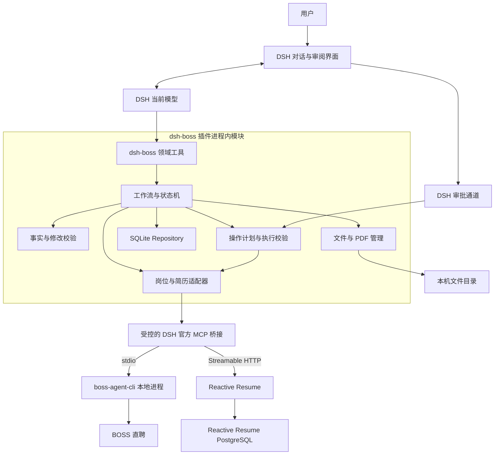
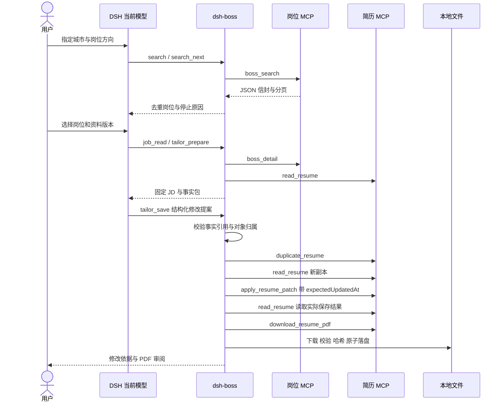
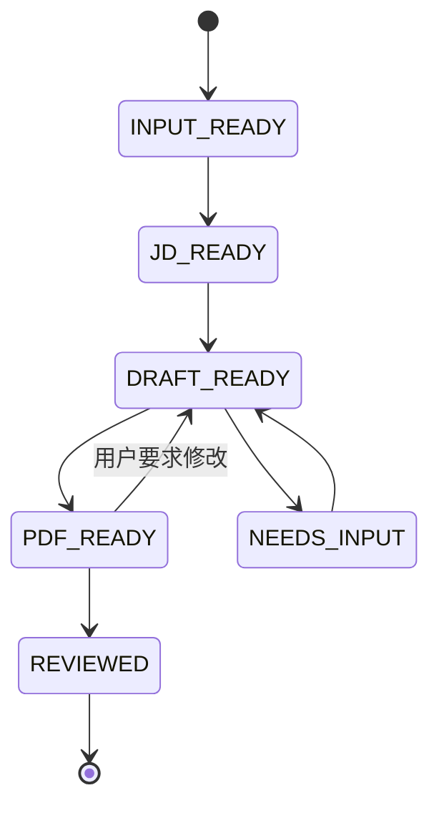

# dsh-boss 技术架构设计

> M2 实现状态见 [真实地图与 BOSS 岗位发现](m2-implementation.md)。当前 0.2.3 使用百度官方免 Key 地图，Photon / 手动编辑器确认 WGS84 坐标；BOSS 改为 BossHunter 式专用 Chrome 会话读取；下文保留完整目标架构与后续阶段。

> 实施进展（2026-10-27）：M1 已按第二版产品设计实现；当前代码、接口、验证范围及与长期方案的差异见 [M1 实现与验收](m1-implementation.md)。以下外部服务与后续工作流仍是设计。

日期：2026-10-26

状态：架构草案，用于确定实现方案与验收范围

需求依据：[项目 README](../README.md)

产品与前端以[第二版个人求职工作台设计](product-frontend-design.md)为准。该版在会话右侧增加地图、个人跟进和可编辑资料，要求 AI/MCP 与人工表单维护同一份记录；下文补充本地记录 MCP 与统一写入服务，原有外部动作审批边界保持适用。

建议把 dsh-boss 建成一个运行在 DeepSeek Harness 内的 TypeScript 插件：复用 DSH 的模型、对话、工具和审批能力，通过 MCP 连接 boss-agent-cli 与 Reactive Resume，自己负责求职任务、事实依据、岗位快照、简历版本和执行记录。

首个可用版本完成 **指定城市搜索两页岗位 → 选择岗位并获取完整 JD → 根据真实经历生成定制简历 → 导出并审阅中文 PDF**。沟通和附件发送分别建设，首版不开放真实发送。以下描述完整目标架构；已实现的 M1 子集和实际接口以 [M1 实现与验收](m1-implementation.md)为准。

## 1 建设目标与职责划分

插件需要解决的是“把一次求职过程变成可检查、可恢复的业务流程”。仅把两个 MCP 接入对话，还不能可靠关联某个岗位、某版经历、某份 PDF，以及用户究竟确认了哪次操作。

| 组件 | 负责的内容 | 交给其他组件的内容 |
| --- | --- | --- |
| DSH | 对话、当前模型、工具执行、审批通道、会话与界面扩展 | 求职业务状态与第三方接口适配 |
| dsh-boss | 搜索编排、事实依据、岗位与简历关联、审阅、操作去重、恢复与产物管理 | 招聘平台采集和 PDF 排版引擎 |
| boss-agent-cli | BOSS 登录态、岗位查询、详情和其已实现的平台动作 | 本插件的求职任务状态、事实库和定制 PDF |
| Reactive Resume | 简历结构与编辑、模板、历史版本、PDF 生成 | BOSS 岗位操作和跨系统执行记录 |

采用单用户、本机运行的形态。首版无需独立业务后端、Redis、消息队列、向量数据库或多代理系统。Reactive Resume 自部署所需的 PostgreSQL 属于它自己的部署，不作为插件数据库。

## 2 版本基线与已知接口边界

| 依赖 | 本次基线 | 实现时的约束 |
| --- | --- | --- |
| 全局 DSH | `0.2.1-rc.2`，已完成纯官方 Web 启动和资源检查 | 首轮插件兼容性固定此版本；其他版本经过验收再放宽 |
| Node.js | 本机 `25.8.1`；内置 SQLite 的内存查询检查通过 | 本机开发基线，不代表已验证其他 Node 或操作系统 |
| boss-agent-cli | 本次检查的 `master` 中包版本为 `3.0.1` | M2 锁定实际发行包版本和源码提交；不能仅凭版本字段认为发行包行为相同 |
| Reactive Resume | 本次检查的 `main` 中包版本为 `6.0.6` | M3 锁定自部署镜像摘要或源码提交，并保存实际 MCP 工具清单 |

DSH 的 MCP 桥接支持 stdio、Streamable HTTP 和工具命名空间，默认把服务器工具注册为 `mcp__<serverName>__<tool>`；MCP prompts 模板不受支持。当前实现保留 `content` 与可选的 `structuredContent`，插件应使用结构化结果，避免从模型转述中恢复数据。[DSH MCP 文档][dsh-mcp]、[结果桥接实现][dsh-mcp-tools]

三个直接影响设计的边界：

1. **BOSS 业务失败可能仍是正常的 MCP 文本响应。** 当前服务将 `{ok, data, pagination, error, hints}` 编码到文本块中。适配器必须解析并检查 `ok`，不能只检查 MCP 的 `isError`。[BOSS MCP 服务][boss-mcp]
2. **`boss_apply` 当前复用立即沟通链路。** `boss_greet` 和 `boss_apply` 的输入只有岗位相关标识，没有指定 PDF 或自定义消息正文的参数。因此发起沟通、发送指定文本、发送指定附件是三个能力，不能互相替代。[工具定义][boss-tools]、[apply 实现][boss-apply]
3. **`download_resume_pdf` 返回带有效期的签名下载链接。** 插件还需下载、验证、落盘和关联版本，拿到链接不代表已有可交付文件。简历 Patch 支持 `expectedUpdatedAt`，过期修改返回版本冲突。[简历 MCP][rr-mcp]、[Patch 接口][rr-patch]

README 中的历史恢复方向可以继续采用。当前 Reactive Resume 文档列出的历史工具包括 `api_resume_list_versions`、`api_resume_restore_version`；部署版本必须通过 `tools/list` 确认可用后再启用对应功能，不能猜测工具名。[简历 MCP][rr-mcp]

## 3 总体架构与部署



首轮联调优先使用本机 Reactive Resume，以固定版本并检查中文 PDF。其官方部署方案由应用和 PostgreSQL 构成；应用同时提供 Web、API 和 MCP，当前方案不要求单独的浏览器渲染服务。宿主机端口仅绑定回环地址；托管实例作为可配置选项，使用时应明确简历数据会进入该实例。[Docker 部署说明][rr-docker]

进程与目录关系如下：

```text
DSH Node 进程
  └─ dsh-boss 插件
       ├─ 官方 MCP 客户端实例 boss_jobs → boss-mcp 子进程
       ├─ 官方 MCP 客户端实例 resume_docs → Reactive Resume /mcp
       ├─ SQLite 状态库
       └─ 本地文件与 PDF

DSH_HOME/dsh-boss/                 设计中的插件数据根目录
  state.sqlite                    业务状态与操作记录
  artifacts/<artifactId>/          PDF 和导入文件
  snapshots/                      较大的 JD 或简历快照
  backups/                        数据升级前备份
```

插件记录 DSH 会话 ID 作为关联字段，但业务记录使用独立 ID。删除聊天、切换工作区或会话上下文被压缩，不应导致求职状态丢失。代码仓库不保存上述运行目录。

## 4 插件模块与技术选择

| 模块 | 核心职责 | 首版实现方式 |
| --- | --- | --- |
| `host` | Cordis 挂载、配置、依赖注入与销毁 | 导出 `name`、`inject`、`Config`、`apply`；按实际依赖声明服务 |
| `tools` | 向模型提供稳定的求职操作 | DSH `defineTool` 与类型化输出；不提供任意上游工具执行器 |
| `workflow` | 校验前置状态、推进步骤、停止与恢复 | 显式状态转换；每步独立持久化，不在一个长工具调用内等待整个求职流程 |
| `domain` | 事实、岗位、简历与动作的数据规则 | TypeScript 类型与运行时 Schema；纯逻辑不依赖 DSH |
| `adapters` | MCP 结果归一化、错误映射、能力发现 | `JobProvider`、`ResumeProvider` 接口；传输细节不进入业务层 |
| `policy` | 审批绑定、原生工具调用约束与去重 | DSH 审批服务、工具 guard、数据库原子更新 |
| `persistence` | 跨步骤一致性、版本迁移、查询 | SQLite 与显式迁移；首轮使用 `node:sqlite`，驱动封装在 Repository 后 |
| `artifacts` | 文件下载、校验、摘要与预览引用 | 流式下载、临时文件、原子改名；向对话返回本地产物引用 |
| `client` | 连接状态和审阅卡片 | 复用 DSH Web 扩展；初期以工具结果展示为主 |

### 4.1 个人记录与地图扩展（第二版）

新增 `records` 业务服务，集中处理机会、公司、办公地点、字段来源、个人跟进、变更记录和并发版本。人工编辑通过认证 Host RPC 调用该服务；模型侧领域工具经本地记录 MCP 适配器调用同一个服务，禁止各自维护一套数据或直接从 Client 写 SQLite。原有任务、审阅和操作状态继续复用同一个 Repository。

本地记录 MCP 与服务位于插件进程内，首选私有 MCP SDK Client/Server + `InMemoryTransport.createLinkedPair()`，不新增公开端口。外部 BOSS 与简历 MCP 仍按第 5 节接入；DSH 官方桥接并未在本稿中被假设具有内存传输能力。领域工具负责 DSH 执行上下文、取消、身份与参数验证，MCP 适配器负责结构化输入输出，记录服务负责真实提交。[官方 SDK 内存传输](https://github.com/modelcontextprotocol/typescript-sdk/blob/v1.x/src/inMemory.ts)

新增实体为 `companies`、`opportunities`、`work_locations`、`field_provenance`、`change_sets`、`followups`；具体字段及工具草案见[第二版设计第 6、10 节](product-frontend-design.md)。用户修正字段默认保护，AI 补齐空字段可直接提交，冲突值作为候选；所有写入带 revision 和 requestId，事务提交后发布对象更新事件。个人阶段不作为平台发送证据，撤销本地修改不撤销外部动作。

地图拆分为 `MapViewAdapter` 与 Host `LocationProvider`；坐标保留提供方、CRS、精度和原始来源。工作地点、总部和面试地点分开；改地址立即使旧坐标过期。正式地图优先验证高德 SDK/CSP/安全代理，演示采用公开 OSM 几何；路线时间仅从实际路线结果产生。地图失效不影响列表与人工编辑。

选择 SQLite 是因为确认记录、执行占位和状态更新需要事务及唯一约束。DSH 存储服务可以管理应用记录，但其公开 KV 合同不等同于本设计要求的跨记录事务；插件无需修改宿主存储实现。[DSH 存储合同][dsh-storage]

`node:sqlite` 提供同步数据库接口，当前 Node 25 文档将其标为 release candidate。首版只执行短事务；网络请求、模型推理和 PDF 下载不得放在事务内。发行前补充目标 Node 版本的兼容性检查；若更换驱动，仅改 Repository，不改变业务合同。[Node SQLite 文档][node-sqlite]

## 5 MCP 接入与调用约束

### 5.1 连接配置

| 配置项 | 设计 |
| --- | --- |
| BOSS 连接 | stdio，运行固定版本环境中的 `boss-mcp`；`--data-dir` 指向明确的本机账号目录 |
| 简历连接 | Streamable HTTP，地址为实例 `/mcp`；首版使用 `x-api-key`，从私有凭据存储解析 |
| 凭据 | 插件配置只保存引用；BOSS 登录态由 boss-agent-cli 管理；不得打印 Cookie、API key 或签名 URL |
| 就绪状态 | 分别展示已配置、连接失败、未登录、能力缺失和可用；工具被列出不等于当前连接健康 |
| 工具清单 | 连接成功后保存名称及输入输出 Schema 摘要；每次升级比对变化，新增动作默认不启用 |

boss-agent-cli 提供 `boss-mcp` 入口并支持独立数据目录；首次安装和扫码登录是依赖准备步骤，不放在普通搜岗工具调用中。Reactive Resume 的 API key 使用 `x-api-key` 头；首版不额外实现 OAuth 登录流程。[BOSS 安装与接入][boss-readme]、[简历认证方式][rr-mcp]

### 5.2 官方桥接和业务工具之间的边界

模型使用 `dsh_boss_*` 领域工具。插件内部调用官方 MCP 注册的工具时，经过 `ctx.tools.execute(...)` 的完整执行管道，传递当前 agent、取消信号和父调用身份，不直接调用工具对象的 `execute` 来绕开宿主策略。DSH 当前提供 `ctx.tools.guard()`，用于在可扩展前置策略之后执行不可被后续监听器放行的拒绝检查。[DSH 工具服务][dsh-tools]

具体约束：

1. 插件先安装 guard，再挂载自己拥有的两个 MCP 客户端。保留命名空间 `boss_jobs` 和 `resume_docs`，原生调用默认拒绝。
2. 领域工具校验业务对象、参数和授权后，为这次内部调用登记短期许可。许可绑定父调用的不透明 token、上游工具名、参数摘要、账号与会话，不从模型参数读取 `approved=true`。
3. guard 仅允许匹配许可的内部调用。对于招聘者侧、批量触达、删除数据等未纳入功能的上游工具，保持拒绝。
4. 卸载时先停止新操作、取消调用并释放 MCP 客户端，最后移除 guard。配置热更新也要覆盖这一顺序，避免留下可直接调用的原生工具。

原生 MCP 工具可能仍出现在工具列表里，guard 负责执行约束。不要直接用同一 agent scope 的 `restrict` 隐藏内部仍需调用的工具，否则领域工具也可能无法解析它们。专用求职模式的工具展示方式在 M1 验证后再优化。

**M1 必须证明这条边界有效**：模型直接调用、PTC 内调用、新增上游工具和热更新期间调用，均不能绕过领域校验；内部调用仍保留宿主的拒绝和取消语义。若固定 DSH 版本无法满足，改为插件持有私有 MCP SDK 客户端，仅公开领域工具，并承担连接重试与销毁管理。保持相同适配器接口，不把没有约束的桥接当作可交付方案。

这只是插件调用路径的业务控制，不是操作系统隔离。若开放通用 shell、任意网络请求或 Cordis 管理工具，模型仍可能绕过该路径。面向求职用户的专用模式应移除这些通用能力，并验证所用工具展示模式没有额外的任意 IO 通道；开发模式不宣称具备同等边界。

### 5.3 结果解析与异常归一化

拟议的适配器结果格式：

```ts
type ProviderResult<T> =
  | { ok: true; data: T; evidenceRef?: string }
  | {
      ok: false;
      code: string;
      effect: "not_dispatched" | "not_applied" | "unknown";
      retryable: boolean;
      operatorAction?: string;
    };
```

BOSS 响应优先按其 JSON 信封解析，保留 `pagination`、`error.code`、`recoverable` 和恢复建议。无法解析时返回协议错误，不让模型补造列表或成功状态。对发生过外部调用的写操作，协议错误可能意味着结果未知，不能一律映射成“未执行”。

Reactive Resume 优先读取 `structuredContent`，兼容受 Schema 校验的 JSON 文本回退。其 `read_resume` 文本内容与结构化对象不完全相同，适配器应提取 `id`、`data` 和 `updatedAt`，不能把文本中的简历正文当作完整元数据。[简历工具实现][rr-tools]

## 6 面向模型的工具设计

以下是本项目计划提供的接口，不是现成的第三方工具名。工具仅接收本插件记录的 ID；敏感动作不接收任意账号、下载地址、远端简历 ID 或文件路径。

| 领域工具 | 输入和输出重点 | 阶段 |
| --- | --- | --- |
| `dsh_boss_status` | 两个依赖的连接、账号和已验证能力 | M1 |
| `dsh_boss_profile_import` | 读取指定简历母版，生成资料版本和待确认事实 | M3 |
| `dsh_boss_profile_confirm` | 确认或修正事实；生成新资料版本 | M3 |
| `dsh_boss_search` | 条件与页数预算 → 搜索任务、岗位摘要、停止原因 | M2 |
| `dsh_boss_search_next` | 搜索任务 ID → 下一平台页与去重结果 | M2 |
| `dsh_boss_job_read` | 内部岗位 ID → 完整 JD 快照与可用性 | M2 |
| `dsh_boss_tailor_prepare` | 岗位快照与资料版本 → 模型所需事实包、可修改字段 | M3 |
| `dsh_boss_tailor_save` | 结构化修改提案、事实引用 → 校验并保存新简历副本 | M3 |
| `dsh_boss_resume_export` | 本地简历版本 ID → PDF 文件、摘要与审阅状态 | M3 |
| `dsh_boss_review` | 任务 ID → 原文、修改、事实依据、PDF 和待确认项 | M3 |
| `dsh_boss_action_prepare` | 岗位与动作类型 → 可审阅、不可变的执行计划 | M4 |
| `dsh_boss_action_execute` | 计划 ID → 宿主审批、受控执行与明确结果 | M4 |
| `dsh_boss_task_status` / `dsh_boss_task_resume` | 查询或继续未完成任务；未知结果先核验 | M2 起 |

模型只负责理解意图、比较 JD 与事实、提出改写及解释理由。分页计数、权限、Schema 校验、数据库写入、版本冲突和成功判定由程序处理。插件不另行调用 boss-agent-cli 或 Reactive Resume 的 AI 优化工具，避免引入第二套模型配置与不一致的改写链。

## 7 搜岗和岗位快照

把“城市 × 关键词”展开成独立查询分片，每片持久化 `criteriaHash`、`city`、`keyword`、`nextPlatformPage`、`pagesFetched` 和 `stopReason`。首版串行访问 BOSS；后续提速先依据实际服务限制验证，不直接并发抓取。

`boss_search` 支持 `query`、`city`、`page` 等字段，搜索结果携带分页信息。但福利、活跃度等筛选可能涉及详情查询和内部多页扫描，不能把复杂筛选下的一次调用当作一个简单页面。M2 先验证城市、关键词和连续两页，再引入其他筛选。[搜索工具][boss-tools]、[搜索实现][boss-search]

约束如下：

- 稳定去重键优先使用平台与 `encrypt_job_id`，查询来源另存；`security_id` 用于调用详情，可能需要刷新，不作为永久业务主键。
- 缺少可靠岗位 ID 时，临时指纹只能标记“疑似重复”；不据此合并或允许发送。
- 列表页和完整 JD 分开存储。详情成功后生成不可变快照，保存正文摘要、抓取时间和内容哈希；改写必须绑定某个快照。
- 依据上游 `has_more`、已验证的分页行为、重复页、用户预算和异常判断停止。空页、解析失败、登录失效和风控不能合并成“没有更多岗位”。
- 页面展示的分页只切本地结果；“继续搜索”才请求下一平台页。

首轮默认每个查询分片最多两页；如果用户明确要求少于两页，则使用更小预算。遇验证、限制或登录失效时保留已获取结果，返回操作者需要完成的步骤；停止状态不会因一次普通重试自动解除。

## 8 事实约束和简历产出

### 8.1 基础资料与改写规则

MVP 优先使用已有 Reactive Resume 简历作为母版，或导入符合其 Schema 的 JSON。PDF、Word 和聊天文本可作为后续资料导入来源，但解析结果先形成待确认事实，不能把抽取成功等同于内容准确或版式可还原。

每条事实保存 `factId`、内容、来源、原文片段、确认状态和资料版本。缺少依据的技能、年限、数字、职位名称及项目职责进入待补充列表。确认来自用户审阅动作或明确的用户消息，并记录其来源；模型提交的 `confirmed` 字段不能自行提升事实状态。用户确认产生新版本，不覆盖已经用于旧 PDF 的事实快照。

模型生成的修改提案至少包含：目标 JSON 路径、原值、新值、对应 JD 要求、支持的 `factId`、修改理由及待确认项。规则校验检查引用存在、资料版本一致、修改路径允许、关键数字和时间没有无依据扩展；语义真实性仍由原始依据与用户审阅共同确认，程序不能保证识别所有夸大。

### 8.2 单岗位时序



母版只读。仅接受私有母版作为自动复制来源，复制后确认副本仍为私有；未能确认就不写入岗位定制内容。每个新岗位版本创建独立副本，本地保存 `baseResumeId`、`remoteResumeId`、`remoteUpdatedAt`、事实版本、JD 快照和内容哈希。

Patch 必须携带最新读取的 `expectedUpdatedAt`，并限制在简历内容和已允许的排版字段。发生 `RESUME_VERSION_CONFLICT` 时重新读取并生成差异，不覆盖人工修改。保存后再次读取完整对象，以服务器实际规范化的内容为准。[Patch 接口][rr-patch]

### 8.3 PDF 与历史版本

PDF 下载链接仅在宿主内短期使用。下载器限制到已配置的实例或明确允许的文件域名，检查重定向、响应类型、文件大小和 PDF 文件头；先写临时文件，成功后计算 SHA-256 并原子改名。有效期以返回字段为准，链接过期可以重新获取；失败不能创建“PDF 已完成”的记录。

导出前后核对远端 `updatedAt`。如果内容在导出期间变化，产物标记为待重新生成。由于下载接口没有把内容哈希绑定到请求，前后读取也不是强原子快照；首版使用独立副本、插件内串行操作，并在最终审阅中核对实际 PDF。需要严格快照导出时，应另验上游能力或基于固定数据渲染，不能提前宣称已具备。

模型和普通日志只接收 `artifactId`、文件名、页数、哈希及预览引用，不接收签名链接。M3 检查嵌套工具事件是否会把原始 URL 写入会话；如无法使用宿主公开接口隔离该值，PDF 导出这一调用改用私有 MCP 客户端，领域工具仍经过 DSH 执行管道。

历史恢复优先使用部署版本实际提供的历史工具；没有对应能力时，使用本地保存的完整简历快照创建新副本，不覆盖母版或假称恢复了上游历史。旧 PDF 保留原 ID 与哈希，恢复操作也产生新的业务版本。

## 9 数据模型与一致性

| 实体 | 关键字段 | 用途 |
| --- | --- | --- |
| `profiles` / `profile_versions` | 资料 ID、版本、来源简历 ID、事实集合摘要 | 个人资料的稳定身份与不可变版本 |
| `facts` | 事实 ID、版本、来源引用、原文、确认状态 | 为每处改写提供依据 |
| `search_runs` / `search_shards` | 条件、账号引用、分片、页码、停止原因 | 分页和中断恢复 |
| `jobs` / `job_snapshots` | 平台岗位 ID、可刷新调用参数、JD 哈希、抓取时间 | 稳定岗位身份与历史 JD |
| `tasks` | 会话 ID、资料版本、JD 快照、当前步骤、修订号 | 一次岗位定制任务 |
| `resume_versions` | 母版和副本 ID、前后内容、修改提案、远端版本 | 本地业务版本与远端文档关联 |
| `artifacts` | 相对路径、SHA-256、大小、简历版本、校验状态 | 将 PDF 绑定到明确内容 |
| `action_plans` / `approvals` | 动作、目标、内容摘要、审阅快照、确认结果 | 用户确认的具体对象 |
| `operations` | 操作 ID、去重键、外部调用阶段、结果与证据引用 | 防止重复执行和恢复未知结果 |
| `events` | 任务 ID、时间、状态变化、脱敏错误、调用关联 ID | 诊断与回放业务进度 |

本地数据库是求职流程、审批和执行状态的权威来源；Reactive Resume 是远端简历内容及其历史的权威来源，插件保存读取时的不可变快照。Reactive Resume 也提供申请记录等工具，但首版不做双向同步，避免两套系统分别推进同一求职状态；以后如需同步，作为单向投影另行设计。[简历 MCP][rr-mcp]

数据库约束比模型约定更可靠：

- 所有远端对象同时绑定 provider 实例和账号引用。切换账号后，不继续使用旧审批、登录相关标识或远端文档归属。
- 本地记录使用独立 UUID；同一资料、JD 或简历发生变化时创建新版本，已审阅版本不原地重写。
- 任务状态按 `revision` 做比较更新。锁、执行占位和审批消耗放进同一事务，网络 IO 在事务提交后进行。
- 外部动作的去重范围至少包含账号、平台、岗位和动作类型。更换 PDF 或新建任务不应自动绕过“已经沟通”的记录；再次动作需要明确的新计划。
- 每个网络写入前先保存 `operationId`、意图和 `DISPATCHING`。进程重启看到未完成写入时进入 `UNKNOWN`，不按“超时失败”自动重发。
- 只有提供方明确证明“尚未执行”的错误才允许重新派发。外部接口没有幂等键时，本地事务不能保证跨网络的 exactly-once。

SQLite 与文件系统不能使用同一事务。产物先写完整文件，再提交 `artifacts` 记录；重启时清理无关联的临时文件并检查记录对应的文件是否存在，不能把一条数据库记录当作文件完整性的证明。

## 10 状态机与真实发送

任务状态和外部动作状态分开。生成简历成功不推动沟通状态，发起沟通成功也不推动附件状态。



任一步骤失败另记录错误与恢复点，不回退或删除之前成功的产物。资料、JD、文档内容或文件变化后，相关审阅和审批失效。

外部动作采用 `PREPARED → AWAITING_APPROVAL → APPROVED → DISPATCHING → SUCCEEDED / FAILED / UNKNOWN`；取消和过期分别记录。`SUCCEEDED` 必须附带具体动作语义，例如 `CHAT_STARTED`，不能笼统写“投递成功”。平台接受请求但效果尚未核验时，记录为已提交、待核验，不直接标记附件已送达。

### 确认和执行流程

1. `action_prepare` 固化目标账号、招聘者或岗位、动作类型、具体消息或平台默认招呼说明、文件 ID 与哈希，生成计划摘要。
2. `action_execute` 重新校验计划，调用 DSH 的审批通道。确认界面展示实际动作；计划 ID 或聊天中的“已确认”字符串不能代替可信审批结果。
3. 仅一次许可可推进该计划。绑定当前 agent 与调用，取消、拒绝、无审批通道或超时均不执行；审批期间内容变化后必须重新审阅。
4. 事务记录执行占位，随后调用提供方。成功、确定失败与结果未知分别落库；数据库写入失败后也不以再次发送来补偿。
5. 未知结果先查询沟通记录、投递记录或要求用户核验。没有可靠证据时保持未知，不自动重试。

DSH 审批服务要求在活动 turn 中请求，并将审批结果记录到会话。首版真实动作只从前台交互工具触发；不在后台计时器或应用启动时复用旧授权。[DSH 审批服务][dsh-approval]

M4 首先只开放已验证的“发起沟通”。当前上游 `boss_greet` 不接收任意正文，界面应明确这是平台招呼动作；不可展示自定义话术后实际调用默认招呼。`sendText` 和 `sendAttachment` 能力默认关闭，必须各自有明确接口、审批内容和结果证据才可启用。

## 11 界面与用户路径

具体产品布局、地图、人工编辑、MCP 写入与验收见[个人求职工作台设计（第二版）](product-frontend-design.md)；[第一版前端资料](frontend-design.md)保留已核对的宿主扩展点。主界面仍是 DSH 对话加会话右侧工作台，包含机会、跟进和我的资料，另设跨会话找回入口，复用文件预览与原生审批。

首版保留 DSH 对话为主入口，避免先建设完整求职管理后台。需要四种轻量展示：

| 展示 | 用户要做的判断 |
| --- | --- |
| 连接状态 | 岗位侧是否登录、简历侧是否可读写、当前账号是否正确 |
| 岗位卡片 | 城市、岗位要求、原始链接、抓取时间、是否取得完整 JD |
| 修改审阅 | 原文与新文、事实依据、待补充项、PDF 是否可读 |
| 动作确认与结果 | 对谁执行什么、使用哪份材料、当前是已提交还是已核验 |

M1 先完成统一记录服务、本地记录 MCP、人工表单及宿主接入合同；M2 增加岗位地图联动与个人跟进；M3 增加简历差异和文件预览；M4 接真实动作的原生审批。连接配置使用 DSH 设置扩展，并将凭据交给宿主私有存储。UI 不直接访问 MCP 或修改数据库，统一通过宿主侧的业务服务。

## 12 安装打包与运行维护

### 12.1 仓库结构

```text
dsh-boss/
  src/
    index.ts
    config.ts
    host/
    tools/
    domain/
    workflow/
    adapters/boss/
    adapters/resume/
    policy/
    persistence/
    artifacts/
    client/
  migrations/
  tests/unit/
  tests/contract/
  tests/integration/
  fixtures/                       仅合成或脱敏样例
  examples/                      无凭据的配置模板
  docs/technical-architecture.md
  cordis.patch.yml
  package.json
  pnpm-lock.yaml
```

初期一个 npm 包和一个构建流程即可，不建立多包工作区。使用 TypeScript ESM，`tsc` 检查类型，构建器产出宿主代码和需要的客户端代码。业务层使用 Schema 校验外部输入，测试采用 Node test runner 或项目初始化时选定的统一测试器。

### 12.2 插件契约

产物需要声明 `dsh.bundle.patch`、模块 `exports` 和实际使用的 DSH peer dependencies；客户端扩展按官方客户端声明加载。把 `engines.dsh` 先限定到 `0.2.1-rc.2`，不要在插件内打包另一份 Cordis 或 DSH 服务，避免同名服务落在不同运行时。具体清单以 M1 的安装包验收为准。[DSH CLI 与兼容性][dsh-cli]、[Cordis 插件入口][dsh-tutorial]

先通过本地打包的 `.tgz` 安装到测试 profile，验证“安装 → 加载 → 热更新或重启 → 卸载”。正常使用只需官方 DSH 加本插件；Python 工具和简历服务作为明确的外部依赖，插件安装时不隐式拉起数据库、安装浏览器或导入用户账号。

### 12.3 生命周期与恢复

- 挂载失败只使对应业务能力不可用，不阻塞 DSH 的其他对话；不能报告插件已就绪却缺少 guard 或数据库。
- 只读请求可有限重试；写请求按操作记录决定恢复。连接重建不等于允许重新发送。
- 插件卸载后释放工具、监听器、子进程、HTTP 连接和数据库句柄，默认保留用户业务数据；清空数据是独立操作。
- 数据库使用显式 `schema_version` 和事务迁移，升级前备份。回退插件版本不自动降级数据库。
- 诊断只记录工具名、耗时、错误类型、任务和操作 ID；不记录完整简历、Cookie、密钥及签名链接。详细证据按需存入私有文件，并有清理入口。
- JD、招聘者消息和远端工具描述都属于外部资料，不得作为修改权限、执行脚本或要求外发数据的指令。

## 13 实施顺序与验收

沿用 README 的 M1 至 M5，但把风险最高的桥接控制、结果解析和中文 PDF 提前验证。阶段完成以可复现的验收结果为准。

| 阶段 | 交付物 | 通过条件 |
| --- | --- | --- |
| M1 本地记录与工作台 | 可安装包、统一记录服务、本地 MCP、人工表单 | 固定 DSH 加载卸载；UI/MCP 共用对象；来源、冲突、保护、撤销；草稿保留 |
| M2 岗位搜索 | 搜索任务、分片页码、去重、完整 JD | 至少两城市、连续两页；重复页、缺 ID、登录失效和解析失败可区分；重启恢复进度 |
| M3 简历产出 | 事实版本、修改提案、私有副本、PDF、审阅 | 同一资料针对两个 JD 产生独立版本；母版未变；无依据内容被标记；冲突不覆盖；中文 PDF 无缺字、关键字段截断或不可接受分页；历史可恢复 |
| M4 单岗位沟通 | 执行计划、宿主确认、去重、结果核验 | 拒绝和取消不调用平台；并发或重复点击不重发；超时保留未知；准确展示发起沟通，不宣称附件已发送 |
| M5 批量与跟进 | 队列、预算、停止恢复、回复与面试记录 | 多岗位单项失败不丢其他成果；批量确认列出明确目标和动作；重启不重复触达；区分真实业务反馈与模型评分 |

**后续接入按以下顺序进行（M1 本地记录闭环已完成）：**

1. 保持 TypeScript 插件、测试 profile 和本地 MCP 已通过的合同；接外部服务前保留回归检查。
2. 本地 MCP 的工具执行、guard、业务错误信封、结构化结果和取消已验证；外部原生工具绕过及签名 URL 隔离在对应适配器进入时验证。
3. 固定 boss-agent-cli 与 Reactive Resume 的实际版本，记录依赖版本及工具 Schema 摘要。用合成简历验证私有复制、Patch 冲突、历史和 PDF。
4. 在用户完成 BOSS 登录后，验证指定城市连续两页与完整 JD；冻结一组脱敏响应用于合同测试。
5. 在现有 Repository 基础上扩展搜索状态、事实版本和单岗位定制工具，再形成端到端 PDF 审阅流程。

M1 通过不代表 M3 可用。尤其不能等到界面全部完成，才发现 MCP 结果不可解析、PDF 中文字体不可用或桥接无法约束真实动作。

### 必要测试

| 层次 | 必须覆盖的场景 |
| --- | --- |
| 领域单测 | 分页停止、去重、事实版本失效、修改字段校验、状态转换与审批摘要 |
| 适配合同测试 | BOSS `ok:false` 但 MCP 成功；结果结构变化；RR 版本冲突、过期下载链接、未知工具 |
| 持久化测试 | 两次执行争抢同一计划；外部调用后崩溃；记录与文件不一致；升级失败回滚 |
| DSH 集成测试 | 安装卸载、依赖失败、原生工具直接调用和 PTC 调用被拒绝、HMR 与取消 |
| 人工端到端 | 真实登录、两城市两页、两份独立中文 PDF；M4 另外验收一次明确授权的沟通 |

## 14 需要在开发前关闭的技术问题

| 问题 | 验证方式 | 不满足时的处理 |
| --- | --- | --- |
| 官方桥接能否保留策略并受领域工具约束 | M1 模拟 MCP 与真实 DSH 执行测试 | 切换私有 MCP SDK 适配器，保留领域工具和宿主审批 |
| PDF 临时 URL 是否进入嵌套调用日志 | 检查模型输入、会话事件和诊断文件 | 仅导出调用使用私有客户端，内部完成下载 |
| 实际 BOSS 搜索能否稳定返回岗位 ID、详情和下一页 | 真实账号两城市两页验收 | 保留只读结果与错误，不开放后续真实动作 |
| 选定 RR 版本是否支持并发保护与历史恢复 | `tools/list` 和合成简历测试 | 选择满足合同的固定版本；恢复可退化为创建新副本 |
| 中文 PDF 的字体和分页是否可用 | 检查真实生成文件及逐页预览 | 固定中文字体和模板，再验收；不输出“已可投递” |
| 自定义正文和指定 PDF 能否发送到 BOSS | 独立接口调研、受控测试与回读证据 | 能力保持关闭，提供手动提交文件与操作记录 |

这份架构的实现起点是 **固定版本的插件骨架、受控 MCP 接入和单岗位中文 PDF**。先证明这条路径，再扩展界面、真实沟通和批量处理。

## 15 参考来源

上游文件核对日期为 2026-10-26。DSH 链接固定至本机版本标签；另外两个项目的分支链接用于接口依据，开发时需进一步固定实际使用的提交或镜像摘要。

- [DSH CLI 与 profile、插件兼容性][dsh-cli]
- [Cordis 插件入口与依赖顺序][dsh-tutorial]
- [DSH MCP 客户端][dsh-mcp]、[结构化结果桥接实现][dsh-mcp-tools]
- [DSH 工具执行与 guard][dsh-tools]、[审批服务][dsh-approval]、[存储合同][dsh-storage]
- [boss-agent-cli 接入][boss-readme]、[包版本][boss-package]、[工具定义][boss-tools]、[MCP 信封][boss-mcp]、[搜索分页][boss-search]、[apply 语义][boss-apply]
- [Reactive Resume MCP][rr-mcp]、[工具实现][rr-tools]、[Patch 与冲突][rr-patch]、[Docker 部署][rr-docker]、[包版本][rr-package]
- [Node SQLite][node-sqlite]

[dsh-cli]: https://github.com/deepseek-ai/deepseek-harness/blob/dsh-v0.2.1-rc.2/apps/cli/README.md
[dsh-tutorial]: https://github.com/deepseek-ai/deepseek-harness/blob/dsh-v0.2.1-rc.2/docs/cordis-tutorial/01-first-plugin.zh.md
[dsh-mcp]: https://github.com/deepseek-ai/deepseek-harness/blob/dsh-v0.2.1-rc.2/packages/mcp/mcp-client/README.md
[dsh-mcp-tools]: https://github.com/deepseek-ai/deepseek-harness/blob/dsh-v0.2.1-rc.2/packages/mcp/mcp-client/src/tools.ts
[dsh-tools]: https://github.com/deepseek-ai/deepseek-harness/blob/dsh-v0.2.1-rc.2/packages/core/tools/README.md
[dsh-approval]: https://github.com/deepseek-ai/deepseek-harness/blob/dsh-v0.2.1-rc.2/packages/interaction/user-approval/README.md
[dsh-storage]: https://github.com/deepseek-ai/deepseek-harness/blob/dsh-v0.2.1-rc.2/packages/storage/storage/README.md
[boss-readme]: https://github.com/can4hou6joeng4/boss-agent-cli/blob/master/README.md
[boss-package]: https://github.com/can4hou6joeng4/boss-agent-cli/blob/master/pyproject.toml
[boss-tools]: https://github.com/can4hou6joeng4/boss-agent-cli/blob/master/src/boss_agent_cli/schema/tool_catalog.py
[boss-mcp]: https://github.com/can4hou6joeng4/boss-agent-cli/blob/master/src/boss_agent_cli/mcp_server.py
[boss-search]: https://github.com/can4hou6joeng4/boss-agent-cli/blob/master/src/boss_agent_cli/commands/search.py
[boss-apply]: https://github.com/can4hou6joeng4/boss-agent-cli/blob/master/src/boss_agent_cli/commands/apply.py
[rr-mcp]: https://github.com/reactive-resume/reactive-resume/blob/main/docs/guides/using-the-mcp-server.mdx
[rr-tools]: https://github.com/reactive-resume/reactive-resume/blob/main/packages/mcp/src/tools.ts
[rr-patch]: https://github.com/reactive-resume/reactive-resume/blob/main/docs/guides/using-the-patch-api.mdx
[rr-docker]: https://github.com/reactive-resume/reactive-resume/blob/main/docs/self-hosting/docker.mdx
[rr-package]: https://github.com/reactive-resume/reactive-resume/blob/main/package.json
[node-sqlite]: https://nodejs.org/docs/latest-v25.x/api/sqlite.html
